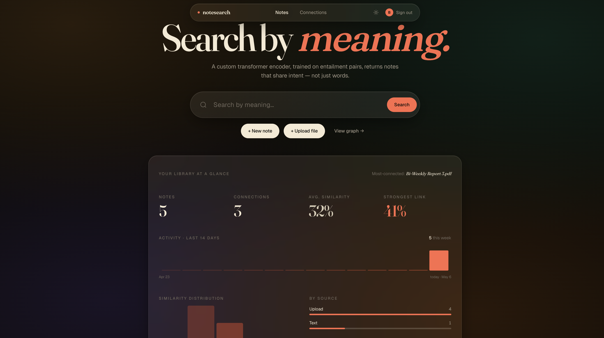
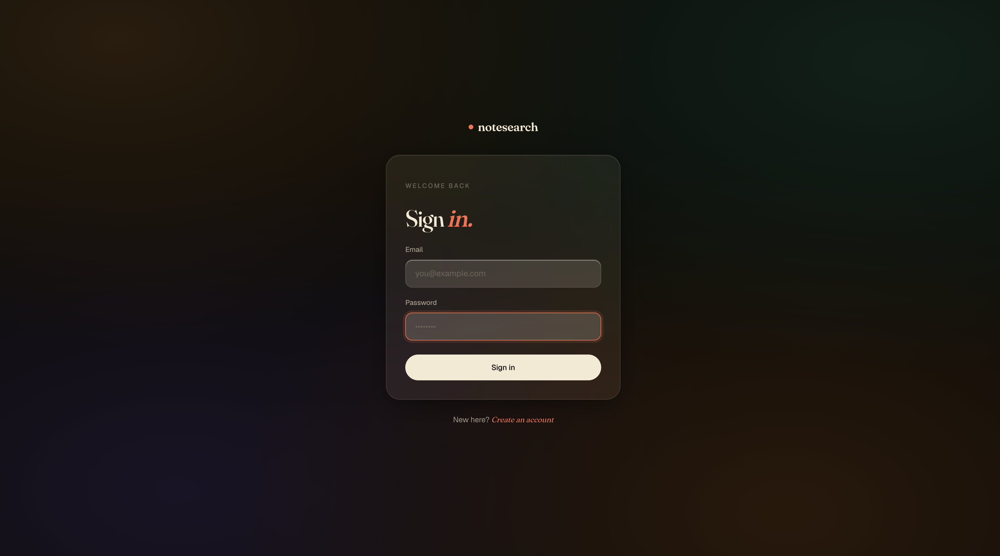
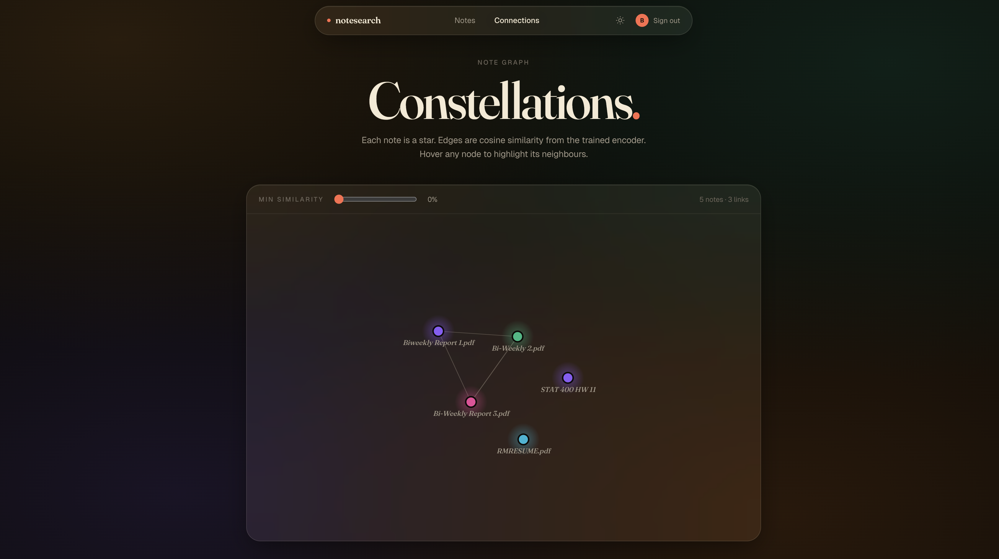

# Notesearch

> Search your notes by what you meant, not what you wrote.



Notesearch is a semantic note-taking app built end-to-end for CS222 SP26. Drop in a `.txt`, `.md`, or `.pdf`; the backend chunks the text, runs it through **a transformer encoder we trained from scratch on NLI entailment pairs**, and stores the resulting 128-dimensional embeddings in Cloudflare Vectorize. Search re-encodes your query with the same model and returns the notes that share *intent* with it — not just words that overlap.

## ✨ Highlights

- **Semantic search.** A query like *"team progress check-in"* surfaces a meeting note titled *"Q2 planning"* without those keywords appearing.
- **Custom encoder, not an off-the-shelf model.** 6-layer transformer with RoPE attention, SiLU/SwiGLU feed-forward blocks, a 10k-token BPE tokenizer we built ourselves, and ~3M parameters. Runs on CPU, no GPU required.
- **LaTeX-aware.** Notes can include `$…$` and `\begin{align*}` blocks; full `.tex` documents render via a small LaTeX preprocessor.
- **Connections graph.** Force-directed layout written from scratch in JavaScript — drag the similarity slider to filter weak edges in real time.
- **Editorial-glass UI.** Custom design system, Fraunces serif headlines, soft mesh-gradient background, light + dark themes.

## Screenshots

| Sign in | Library + stats | Connections graph |
|---|---|---|
|  |  |  |

## Try the live demo

**→ [notesearch-three.vercel.app](https://notesearch-three.vercel.app)**

Sign up with any email + 8-character password and start searching. Frontend is on Vercel, backend on Render's free tier (`notesearch-9vjs.onrender.com`).

A few caveats so you're not surprised:

- **First request after idle is slow.** Render's free tier sleeps the container after 15 minutes of no traffic. Cold start takes ~30 seconds on the first request, then everything's fast.
- **Render memory limits.** Free-tier RAM is too tight for sustained upload traffic — for actual demo uploads, run locally (steps below).
- **Email confirmation is disabled** on the demo Supabase project, so any plausible email works.
- **Don't upload anything sensitive** — shared keys, possibly wiped after grading.

## What's in this repo

```
backend/         FastAPI app + ML pipeline
  app/api/       HTTP routes (auth, notes, search, connections, voice)
  app/services/  encoder, tokenizer, embedding, vector_store, supabase_client
  artifacts/     trained encoder.pt + config.json + tokenizer JSON
  migrations/    SQL for the Supabase notes table
  tests/         pytest suite (50+ tests, mocks Supabase + Cloudflare)

frontend/        React app (Create React App)
  src/pages/     Home, SearchResults, NoteViewer, Connections, Login, Signup
  src/components/ TopNav, SearchBar, NoteCard, NoteComposer, UploadArea, StatsPanel, MathText
```

## Architecture quick reference

```
upload  →  pdfplumber/utf-8 text extraction
       →  word-bounded chunking (≈200 words, 32 overlap)
       →  BPE tokenization (custom 10k-token vocab)
       →  Encoder.forward (6-layer transformer, RoPE attention, SiLU FFN)
       →  mean pool to 128-dim, int8-quantized at runtime
       →  Vectorize upsert with metadata (note_id, chunk_index, snippet, …)

search →  same embedding pipeline on the query
       →  Vectorize query (cosine, top_k * 5)
       →  dedupe by note_id, keep best chunk per note
       →  return top_k with title + preview + relevance
```

---

# Run it locally

## Prerequisites

- **Python 3.11** (the trained encoder ships with the repo and was saved against this version)
- **Node 18+** and **npm**
- A **Supabase** project — free tier is fine
- A **Cloudflare** account with **Workers** + **Vectorize** enabled
- ~13 MB free disk space (for the bundled encoder weights)

## 1. Clone

```bash
git clone https://github.com/SP26-UIUC-CS222/Team-26.058.git
cd Team-26.058
```

## 2. Set up Supabase

1. Create a new project at https://supabase.com/dashboard
2. **Project Settings → API**, copy:
   - `Project URL` (e.g. `https://abcdefg.supabase.co`)
   - `service_role` key (the long JWT — *not* the anon/publishable key)
3. **Authentication → Providers → Email** — uncheck **"Confirm email"** so signups return an access token immediately.
4. **SQL Editor → New query** — paste both files in [`backend/migrations/`](backend/migrations/) and run them.

## 3. Set up Cloudflare Vectorize

You need an index at **dimension 128, metric cosine** to match the encoder output.

```bash
npm install -g wrangler
wrangler login
wrangler vectorize create notes-index --dimensions=128 --metric=cosine
```

Or via the dashboard: **Cloudflare → AI → Vectorize → Create index**, dimensions `128`, metric `cosine`.

Then create an API token at **My Profile → API Tokens → Create Custom Token** with `Account → Vectorize → Edit` and `Account → Vectorize → Read`.

## 4. Backend

```bash
cd backend
python3.11 -m venv .venv
source .venv/bin/activate                        # Windows: .venv\Scripts\activate
pip install -r requirements.txt                  # ~3-5 minutes; pulls torch
```

Create `backend/.env` (gitignored):

```bash
STORAGE_BACKEND=local
LOCAL_STORAGE_PATH=./storage

SUPABASE_URL=https://YOUR-PROJECT.supabase.co
SUPABASE_KEY=eyJ...your-service-role-key...

CLOUDFLARE_ACCOUNT_ID=your-32-hex-account-id
CLOUDFLARE_API_TOKEN=your-vectorize-token
CLOUDFLARE_VECTORIZE_INDEX=notes-index
```

Verify and run:

```bash
pytest tests/                                    # all 50+ tests should pass
uvicorn app.main:app --reload --port 8000
curl http://localhost:8000/health                # → {"status":"ok"}
```

Interactive API docs: http://localhost:8000/docs.

## 5. Frontend

```bash
cd frontend
npm install                                      # ~2-3 minutes
npm start                                        # opens http://localhost:3000
```

The frontend defaults to `http://localhost:8000` for the API. Override via `frontend/.env`:

```bash
REACT_APP_API_URL=http://localhost:8000
```

## 6. End-to-end smoke test

1. Open the frontend → sign up with any email + 8-char password
2. Click **+ New note** to write inline (LaTeX live-previewed) or **+ Upload file**
3. Wait ~5 seconds for Cloudflare to index
4. Search semantically (e.g., "team progress" if you uploaded a meeting note)
5. Click a result → see body, related-notes sidebar with similarity bars
6. Open **Connections** → force-directed graph of your library

---

## Common issues

| Symptom | Fix |
|---|---|
| Backend `503 SUPABASE_URL ... must be set` | `.env` missing or has empty values |
| `400 Email address invalid` on signup | Supabase email validation — use a real-looking domain |
| Signup returns 200 but `access_token: null` | Email confirmation is on — disable it in Supabase Auth → Providers → Email |
| `RuntimeError: Error(s) in loading state_dict for Encoder` | `encoder.py` architecture and `encoder.pt` weights mismatched — pull the canonical pair from `backend/artifacts/` |
| Search returns `[]` after upload | Cloudflare indexing latency (~5s on free tier). Wait and retry. |
| PDF preview shows binary garbage | Re-upload — switched from pypdf to pdfplumber in commit `f342691` |
| Frontend `Failed to fetch` | Backend isn't running, wrong port, or CORS — check `app.main:app` is on port 8000 |

## Tests

```bash
cd backend && pytest tests/ -v
```

50+ tests, ≥80% coverage. Mocks Supabase and Cloudflare so the suite runs without credentials.

## Out of scope (intentionally stubbed)

- `POST /voice/` — AWS Transcribe upload + polling (returns 501)
- `/connections/` similarity is currently Jaccard token-overlap; cosine over the encoder's embeddings is the obvious upgrade

## Authors

CS222 SP26 — Team 26.058

- **Frontend** — Aashna Anand
- **Backend** — Surya Sridharan, Robert Mandell
- **Transformer encoder** — Robert Mandell, Pranav Popuri
